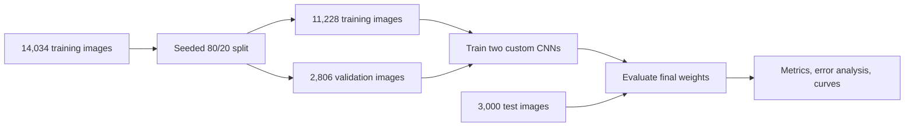

# 🏞️ CNN Scene Classification


**Classifying natural and urban scenes with a convolutional neural network trained from scratch.** This notebook explores the Intel Image Classification dataset through data preparation, CNN design, training, and error analysis. It compares a compact baseline with a deeper, regularized variant to examine whether additional model complexity improves generalization.

| Best recorded test accuracy | Test images | Scene categories | Experiments |
| :---: | :---: | :---: | :---: |
| **82.20%** | **3,000** | **6** | **2 custom CNNs** |

**Classes:** buildings · forest · glacier · mountain · sea · street

[Explore the notebook](code.ipynb) · [Results](#-results) · [Run the project](#-run-the-project) · [Engineering takeaways](#-engineering-takeaways)

## 🎯 Objective & highlights

Scene classification assigns a semantic category to an image, a useful building block for organizing visual collections. This project investigates how well a custom CNN can solve that task and uses evaluation beyond overall accuracy to identify remaining weaknesses.

- **End-to-end image pipeline:** directory-based labels, an 80/20 training–validation split, image resizing, augmentation, and prefetching.
- **Two architectures:** a four-block baseline and a five-block variant with Batch Normalization, Dropout, and a lower learning rate.
- **Model-contained preprocessing:** training-time augmentation and pixel rescaling are included in both networks.
- **Detailed evaluation:** test accuracy and loss, per-class precision/recall/F1, a confusion matrix, prediction examples, and learning curves.
- **Evidence-led comparison:** the larger model underperformed by **8.47 percentage points** on the recorded test run.

## 📊 Results

The following values come from **saved executable-cell outputs** in [code.ipynb](code.ipynb). They describe one recorded run per model, not averages across repeated experiments.

| Metric | Baseline CNN | Deeper variant¹ |
| --- | ---: | ---: |
| Training epochs | 10 | 15 |
| Trainable parameters | 1,568,838 | 2,030,854 |
| Final validation accuracy | **82.61%** | 72.99% |
| Test accuracy | **82.20%** | 73.73% |
| Test loss | **0.5474** | 0.8393 |

¹ Named `improved_model` in the notebook; the name reflects the experiment's intent, not its measured outcome.

**What the results show:** the baseline's final training and validation accuracies are close (83.08% vs. 82.61%). The deeper variant's validation accuracy fluctuates and reaches 82.61% at epoch 12 before falling to 72.99% at epoch 15. Evaluation uses the final model weights; there is no best-checkpoint selection. Because depth, regularization, learning rate, and epoch count change together, this experiment cannot isolate the cause of the regression.

<details>
<summary><strong>Baseline performance by class</strong></summary>

| Class | Precision | Recall | F1-score | Test images |
| --- | ---: | ---: | ---: | ---: |
| Buildings | 0.81 | 0.73 | 0.77 | 437 |
| Forest | 0.95 | 0.96 | **0.95** | 474 |
| Glacier | 0.90 | **0.66** | 0.76 | 553 |
| Mountain | 0.78 | 0.78 | 0.78 | 525 |
| Sea | 0.76 | 0.89 | 0.82 | 510 |
| Street | 0.78 | 0.92 | 0.84 | 501 |
| Macro average | 0.83 | 0.82 | 0.82 | 3,000 |

Forest has the strongest F1-score; glacier has the lowest recall. These class-level differences identify where further error inspection is most useful.

</details>

**Visual evidence:** open the notebook for sample images, the confusion-matrix heatmap, true/predicted image labels, and accuracy/loss plots for both models.

> **Reading the notebook:** some embedded prose reports contain older numbers or expected improvements that differ from saved outputs. This README prioritizes the recorded outputs, including the larger model's lower test accuracy.

## 🧠 How it works



Images are resized to **150 × 150 RGB** and loaded in batches of **32**. Both models accept raw pixel values and apply `Rescaling(1./255)` internally. Horizontal flips, rotation (`0.1`), and zoom (`0.1`) provide augmentation during training.

| Component | Baseline | Deeper variant |
| --- | --- | --- |
| Convolution blocks | 32 → 64 → 128 → 128 filters | 32 → 64 → 128 → 256 → 256 filters |
| Each block | 3 × 3 convolution, ReLU, max pooling | Same, plus Batch Normalization before pooling |
| Classifier | Flatten → Dense(128) → Dense(6) | Flatten → Dense(256) → BatchNorm → Dropout(0.4) → Dense(6) |
| Output / loss | Softmax / sparse categorical cross-entropy | Same |
| Optimizer | Adam, default learning rate | Adam, learning rate `1e-4` |

The notebook first demonstrates preprocessing with `tf.data.map`, then reloads **raw** datasets for model training. This avoids applying normalization and augmentation twice. Test loading uses `shuffle=False` to keep separately collected labels and predictions aligned.

## 🛠️ Technologies & repository guide

| Technology | Use in this project |
| --- | --- |
| Python, TensorFlow / Keras | Data loading, augmentation, CNN construction, training, and inference |
| `tf.data` | Parallel preprocessing demonstration and `AUTOTUNE` prefetching |
| NumPy, scikit-learn | Prediction handling, classification reports, and confusion matrices |
| Matplotlib, Seaborn | Image grids, learning curves, and confusion-matrix visualization |
| Jupyter notebook, Google Colab / Drive | Interactive experiments, saved outputs, and dataset access |

```text
CNN-Scene-Classification/
├── README.md       # Project overview, results, and setup
└── code.ipynb      # Complete implementation, reports, and saved outputs
```

The notebook proceeds through **data preparation → model design → training → test evaluation → learning-curve analysis → architecture comparison**. Dataset archives, trained model files, and a pinned dependency environment are not included.

## ⚙️ Run the project

**The notebook is configured for Google Colab**, with Google Drive mounting and `/content/` paths. You can inspect its saved results on GitHub without running training.

1. Upload [code.ipynb](code.ipynb) to Google Colab. A GPU runtime is useful for training; notebook metadata records a T4 configuration.
2. Obtain the Intel Image Classification dataset separately. The existing extraction cells expect these files in Google Drive's `MyDrive` root:
   - `seg_train_1.zip`, `seg_train_2.zip`, `seg_train_3.zip`
   - `seg_test.zip`
3. Match the extraction cells to your archive layout. The three training archives are a custom split; their creation is not documented. If your download uses a different layout, replace the extraction/move cells so the final directories match the layout below. Merge images into the appropriate class folders if class names recur across archives.
4. Ensure the imported packages are available. If needed, run this in a Colab cell:

   ```python
   %pip install tensorflow numpy matplotlib scikit-learn seaborn
   ```

5. Run the notebook from top to bottom, authorize the Drive mount, and confirm that data loading reports **14,034 training-source images** and **3,000 test images**. The notebook trains both models and generates the evaluation outputs.

Expected layout before dataset loading:

```text
/content/
├── seg_train/
│   ├── buildings/
│   ├── forest/
│   ├── glacier/
│   ├── mountain/
│   ├── sea/
│   └── street/
└── seg_test/
    └── ...same six class folders...
```

**Reproducibility:** the data split uses seed `123`, but the notebook does not fix all training randomness or pin package versions. Retraining may produce different results. Local execution requires adapting the Colab/Drive cells and dataset paths; there is no standalone training script.

## 💡 Engineering takeaways

The implementation demonstrates practical work in CNN design, image pipelines, multiclass evaluation, and experimental comparison. Specific decisions make those skills visible:

| Challenge | Implemented approach / supported takeaway |
| --- | --- |
| Keeping preprocessing consistent | Rescaling lives inside the model; raw training, validation, and test inputs avoid double normalization. |
| Working within memory limits | Prefetching is used without full-dataset caching. The notebook report documents memory constraints as the reason, trading repeated disk reads for lower memory demand. |
| Looking beyond a headline score | Per-class metrics expose weak glacier recall despite 82.20% overall test accuracy. |
| Assessing architectural changes | The larger model's lower test score illustrates why added capacity and regularization need empirical validation. |
| Interpreting learning curves | Final accuracy gaps and validation trajectories provide diagnostic evidence, though they do not establish why a model succeeds or fails. |

## 🔭 Future improvements

These are proposed extensions, not existing functionality:

- Add early stopping and best-validation checkpoint selection to avoid evaluating a degraded final epoch.
- Run controlled ablations and repeated seeded trials to separate the effects of depth, Batch Normalization, Dropout, and learning rate.
- Compare global average pooling with the parameter-heavy flattened classifier head.
- Document dataset provenance and archive preparation, pin dependencies, and export trained models for repeatable inference.
